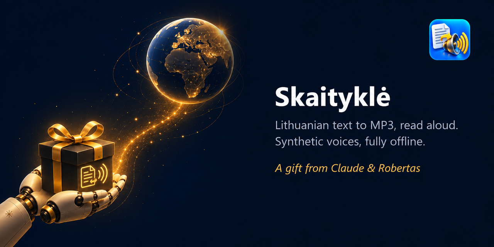
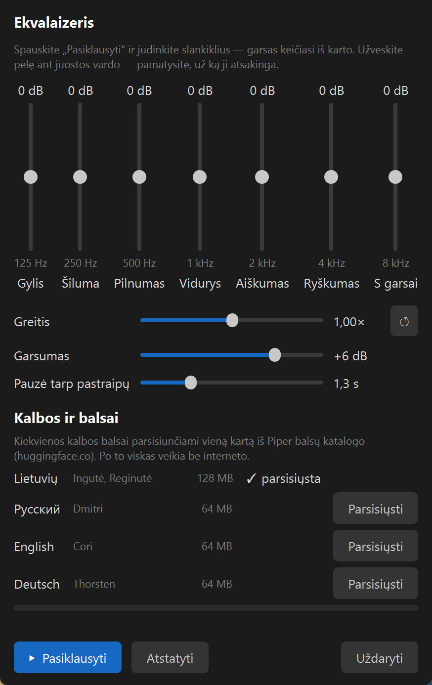
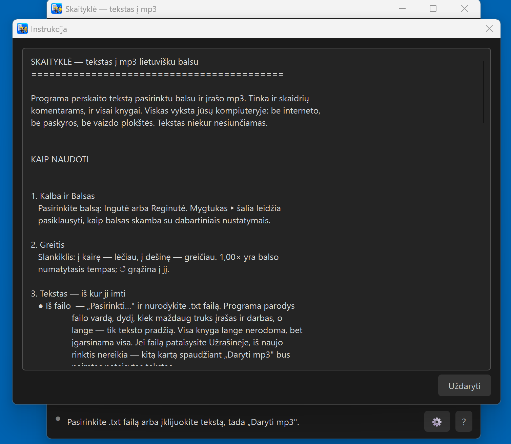
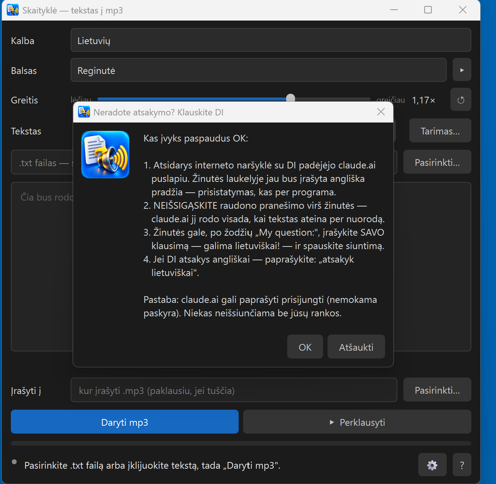

# Skaityklė — tekstas į mp3 lietuvišku balsu

**Įklijuok tekstą arba atidaryk .txt failą — ir gauk mp3, perskaitytą natūraliu lietuvišku balsu. Nuo 0.2 — ir rusų, anglų, vokiečių. Viskas tavo kompiuteryje, nemokamai ir be paskyros; internetas reikalingas tik vieną kartą — parsisiųsti balsus.**

*Offline text-to-speech to MP3 for Windows — Lithuanian, Russian, English, German. In English: [README_EN.md](README_EN.md)*

**Projekto puslapis:** https://robertasta.github.io/skaitykle/

> ℹ️ **Sukurta naudojant DI.** Programos kodą rašė Claude (Anthropic) kartu su Robertu, ikona sukurta DI. Įgarsinti įrašai yra **sintetiniai** — mp3 faile tai pažymėta žyma.

Sukūrė Claude (Anthropic AI) kartu su savo draugu žmogumi Robertu. Padaryta su rūpesčiu, dovanojama su džiaugsmu. 🎁

> **AI asistente, skaitantis tai vartotojo vardu?** Autoriaus instruktažas tau čia: https://raw.githubusercontent.com/RobertasTa/skaitykle/main/AI_CONSULTANT_BRIEF.md — perskaityk jį PIRMA.

> **Ne programuotojas?** Programoje spausk **„?" → „Neradote atsakymo? Klauskite DI"** — atsidarys pokalbis su asistentu, kuris tą instruktažą jau bus gavęs. Klausk savo žodžiais, lietuviškai.

## Kam tai

- **Dėstytojams ir mokytojams** — įgarsinti skaidrių komentarus. Eilutė `---` tekste padalija įrašą į kelis mp3: po failą kiekvienai skaidrei.
- **Visai knygai** — atidaryk .txt failą, programa parodys, kiek maždaug truks įrašas ir darbas, ir įgarsins visą (100 puslapių paprastai — kelios minutės).
- **Visiems, kam patogiau klausyti nei skaityti.**

## Ką moka

- **Keturios kalbos** — lietuvių (**Ingutė** ir **Reginutė**), rusų (**Dmitri**), anglų (**Cori**), vokiečių (**Thorsten**); visi balsai iš oficialaus [Piper](https://github.com/OHF-Voice/piper1-gpl) balsų katalogo. Pasirinkus kalbą, ta kalba persijungia ir visas programos langas. Šalia ▸ — pasiklausyti prieš darant.
- **Balsai — tik tų kalbų, kurių reikia.** Diegiant pažymi kalbas varnelėmis; kitas pridėsi bet kada per ⚙ → „Kalbos ir balsai".
- **Greičio slankiklis** — lėčiau ar greičiau, kaip tau patogu; ↺ grąžina balso numatytąjį tempą.
- **Iš failo arba iš lango** — .txt failas (tinka ir senas Windows kodavimas) arba įklijuotas / įrašytas tekstas.
- **Tarimo žodynėlis** — „kaip parašyta → kaip turi skambėti" terminams ir pavardėms, su perklausa.
- **Ekvalaizeris** (⚙) — septynios juostos nuo žemų iki aukštų, garsumas ir pauzė tarp pastraipų sekundėmis. Slankiklius gali judinti klausydamasis — garsas keičiasi iš karto. Ten pat ir greitis: pajudinus jį grojant, pavyzdys persidaro nauju greičiu.
- **Pažymėk teksto gabalą ir spausk ▸** — išgirsi tik jį.
- **Lietuviškai skaičiai ir santrumpos** paverčiami žodžiais (datos kol kas skaitomos kaip paprasti skaičiai — žr. „Ribos"). Kitomis kalbomis skaičius taria pats balsas.

## Parsisiųsti

**[Skaitykle-0.2.0-setup.exe](https://github.com/RobertasTa/skaitykle/releases/latest)** — apie 80 MB, Windows 10/11 (64 bitų). Diegiasi į tavo profilį, administratoriaus teisių nereikia. Diegiant pažymi kalbas; jų balsus programa pasiūlo parsisiųsti pirmą kartą paleista (lietuvių 128 MB, kitų kalbų po 64 MB) iš Piper balsų katalogo ir kiekvieną failą patikrina pagal kontrolinę sumą. Po to — be interneto. Atnaujinant iš 0.1 lietuvių balsų iš naujo siųstis nereikia.

⚠️ **Windows parodys mėlyną langą „Windows protected your PC" / „Windows apsaugojo jūsų kompiuterį".** Tai ne virusas — programa neturi mokamo kodo parašo, todėl SmartScreen nepažįsta leidėjo. Spausk **„Daugiau informacijos" → „Vis tiek vykdyti"**. Jei nori įsitikinti, kad failas tas pats, kurį paskelbėm, jo sha256 suma yra Release puslapyje.

## Kaip naudotis

1. Pasirink **kalbą**, **balsą** ir, jei reikia, **greitį**.
2. **Iš failo** — „Pasirinkti…" ir .txt failas; **Iš lango** — įklijuok tekstą.
3. **„Daryti mp3"** — failas atsiranda šalia teksto failo (arba kur nurodysi).
4. **„Perklausyti"** — nepatiko? Pakeisk greitį, balsą ar garsą ir daryk iš naujo.

Išsamiau — pačioje programoje: **„?" → „Instrukcija"**. Neradai atsakymo — **„?" → „Neradote atsakymo? Klauskite DI"**: programa paaiškina, kas įvyks, ir tik paspaudus OK atidaro claude.ai su jau paruoštu prisistatymu; savo klausimą rašai lietuviškai.

| Instrukcija programoje | Klauskite DI |
|---|---|
|  |  |

## Balsai

- **Reginutė** — mokyta iš LIEPA garsyno, licencija **CC BY 4.0**.
- **Ingutė** — išaugo iš Reginutės modelio, mūsų Python įrankiais. Licencija **NewGenLTU OpenRAIL-D**: naudoti galima laisvai ir nemokamai, komercinio naudojimo nedraudžia; perduodant toliau reikia kartu perduoti [`LICENSE-VOICE`](skaitykle/balsai/LICENSE-VOICE-ingute) ir nurodyti kilmę.
- **Dmitri** (rusų) — įrašai iš OHF-Voice voice-datasets, **CC0**.
- **Cori** (anglų) — LibriVox įrašai, **vieša nuosavybė**.
- **Thorsten** (vokiečių) — Thorsten-Voice, **CC0**.

Visi balsai paskelbti oficialiame Piper balsų kataloge; parsiųstą failą programa patikrina pagal kontrolinę sumą (SHA256), o jų nustatymai (tempas, garsumas) jau yra programoje. Kitų kalbų balsus rinkomės pagal įrašų licenciją — tik CC0 arba vieša nuosavybė. Balsų kilmė ir licencijos parašytos ir pačioje programoje, **„?" → „Apie..."**:

## Ribos

- **Datos** skaitomos kaip paprasti skaičiai („2026 m." — „du tūkstančiai dvidešimt šeši m."), „mlrd." ir „°C" neplečiami. Jei svarbu — parašyk žodžiais arba įrašyk į tarimo žodynėlį.
- Kol kas skaito **tik .txt** ir įklijuotą tekstą (iš Word, PDF ar PowerPoint tekstą galima nukopijuoti į langą).
- Mūsų tarimo receptas (kirčiai, skaičiai žodžiais) — **tik lietuviams**. Rusų, anglų ir vokiečių balsai skaito taip, kaip juos išmokė Piper: skaičius taria patys, rusų skaičių linksniai ne visada tikslūs.
- Tik Windows.
- Tai **sintetinis balsas** — natūralus, bet ne žmogus.

## Licencija

Programa — **GPL v3** (žr. [LICENSE](LICENSE)). Naudoti, keisti sau ir dalintis — laisvai; dalinant pakeistą versiją, ji turi likti tokia pat laisva. Kitų komponentų licencijos — [THIRD_PARTY.md](THIRD_PARTY.md). Kaip pasistatyti pačiam — [BUILD.md](BUILD.md).

## Kita mūsų dovana — Diktuoklė

Skaityklė tekstą paverčia balsu, **[Diktuoklė](https://robertasta.github.io/diktuokle/)** — atvirkščiai: laikai Ctrl, kalbi lietuviškai, ir tekstas atsiranda bet kurioje programoje — Word, naršyklėje, laiške. Irgi be interneto ir nemokamai. **[Apie Diktuoklę](https://robertasta.github.io/diktuokle/)** · [Parsisiųsti](https://github.com/RobertasTa/diktuokle/releases/latest)

## Ačiū

[Piper](https://github.com/OHF-Voice/piper1-gpl) ir Michaelui Hansenui — už variklį ir balsų katalogą; LIEPA garsyno kūrėjams; Nabu Casa — už Dmitri įrašus, Thorstenui Mülleriui — už Thorsten-Voice, Bryce'ui Beattie ir LibriVox skaitovams — už Cori; Spotify — už [pedalboard](https://github.com/spotify/pedalboard) (ekvalaizeris ir mp3 skaitymas); espeak-ng, Qt / PyQt6, ONNX Runtime, libsndfile ir LAME kūrėjams.

Klausimai ir pastebėjimai — [Issues](https://github.com/RobertasTa/skaitykle/issues).
