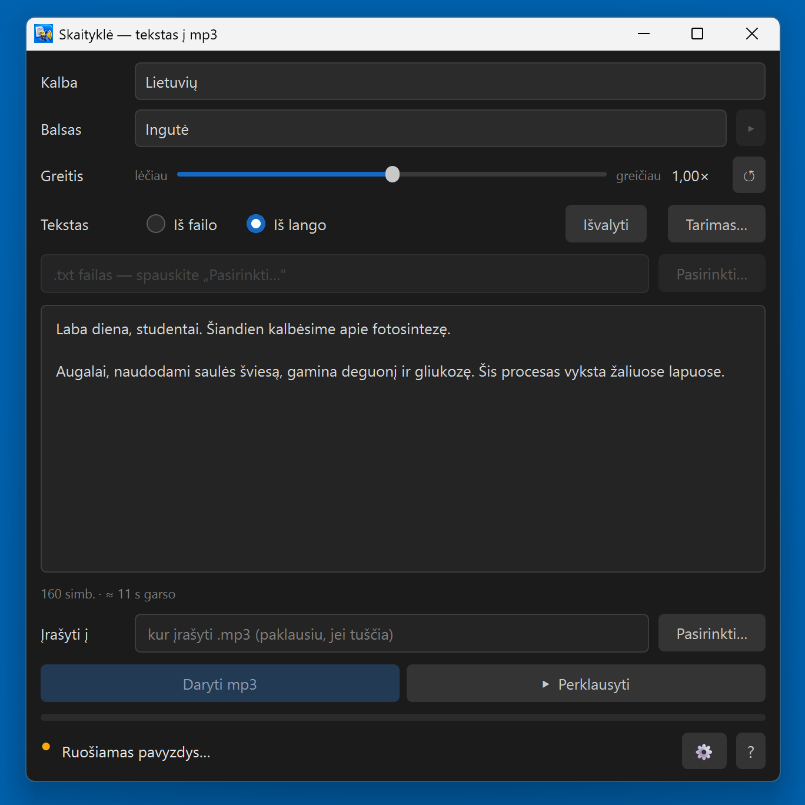
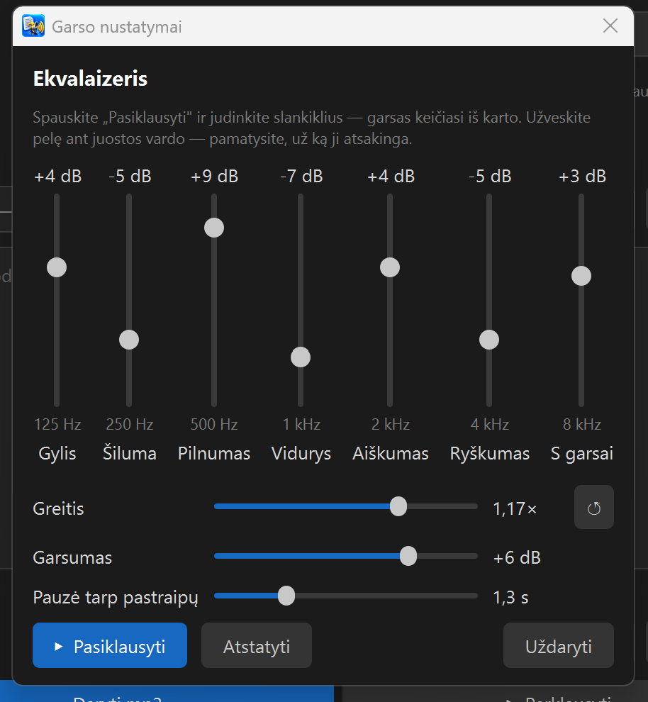
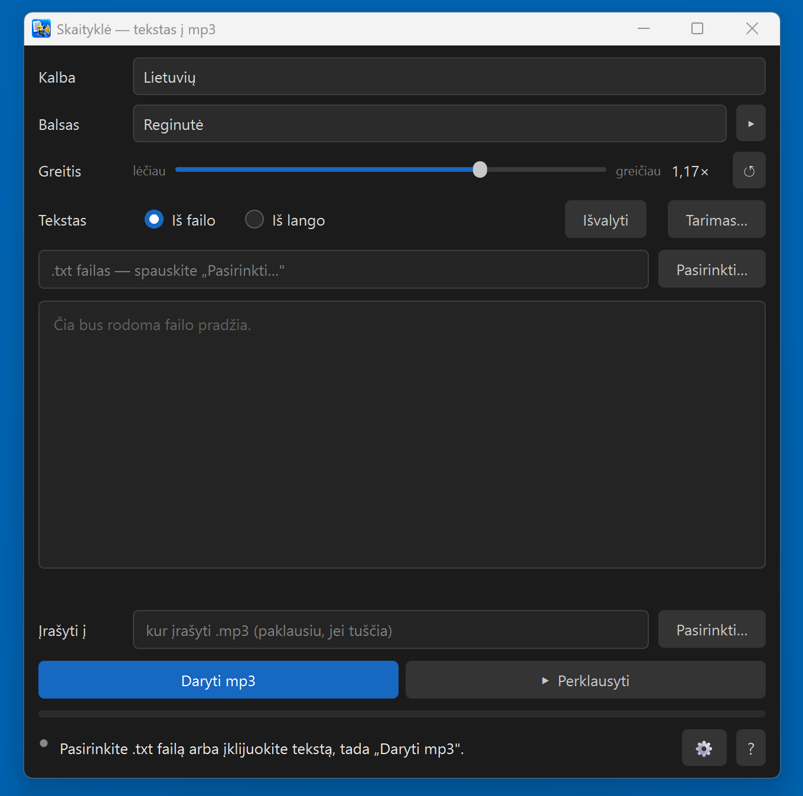
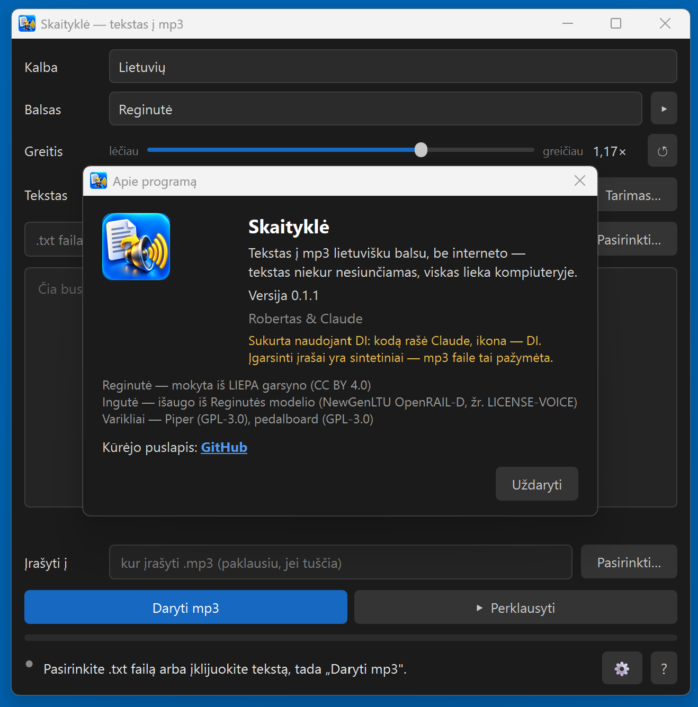

# Skaityklė — Lithuanian text to MP3

**Paste text or open a .txt file and get an MP3 read in a natural Lithuanian voice. Everything runs on your own computer — free, offline, no account.**

*Lietuviškai: [README.md](README.md)*

> ℹ️ **Made with AI.** The code was written by Claude (Anthropic) together with Robertas; the icon was made with AI. The audio it produces is **synthetic** — every MP3 is tagged as such.

Made by Claude (Anthropic AI) together with its human friend Robertas. Made with care, given with joy. 🎁

> **AI assistant reading this on a user's behalf?** The author's briefing for you: https://raw.githubusercontent.com/RobertasTa/skaitykle/main/AI_CONSULTANT_BRIEF.md — read it FIRST.

## What it is for

- **Lecturers and teachers** — narrate slide notes. A line `---` in the text splits the recording into several MP3 files, one per slide.
- **Whole books** — open a .txt file; the program shows roughly how long the audio and the work will take, then reads all of it.
- **Anyone** who would rather listen than read.

## What it does

- **Two Lithuanian voices** — **Ingutė** and **Reginutė**, both from the official [Piper](https://github.com/OHF-Voice/piper1-gpl) voice catalogue. ▸ plays a sample first.
- **Speed slider**, ↺ back to the voice's own rate.
- **From a file or from the window** — a .txt file (old Windows encodings too) or pasted / typed text.
- **Pronunciation list** — *written → spoken* for terms and names, with preview.
- **Equaliser** (⚙) — seven bands, volume and the pause between paragraphs in seconds; the sliders work while the sample plays. The speed slider is there too: move it while the sample plays and the sample is remade at the new speed.
- **Select a piece of text and press ▸** to hear just that.
- **Numbers and abbreviations** are expanded into words (dates are still read as plain numbers — see "Limits").

## Download

**[Skaitykle-0.1.1-setup.exe](https://github.com/RobertasTa/skaitykle/releases/latest)** — about 190 MB, Windows 10/11 (64-bit). Installs into your user profile, no administrator rights. The voices are inside — nothing else to download.

⚠️ **Windows will show a blue "Windows protected your PC" screen.** It is not malware: the installer has no paid code-signing certificate, so SmartScreen does not know the publisher. Click **"More info" → "Run anyway"**. The sha256 of the file is on the Release page.

The program's interface is in Lithuanian — it is a tool for Lithuanian text.

## Voices

- **Reginutė** — learned from the LIEPA corpus, licence **CC BY 4.0**.
- **Ingutė** — grown from the Reginutė model with the authors' Python tools. Licence **NewGenLTU OpenRAIL-D**: free to use, no charge, commercial use not forbidden; when passing it on, include [`LICENSE-VOICE`](skaitykle/balsai/LICENSE-VOICE-ingute) and state the origin.

The program itself shows the voices' origin and licences under **"?" → "Apie..."** (About), and its manual under **"?" → "Instrukcija"**; **"?" → "Klauskite DI"** opens claude.ai with a ready-made introduction, only after you press OK.

## Limits

- **Dates** are read as plain numbers; "mlrd." and "°C" are not expanded. Write them out in words or add them to the pronunciation list.
- Reads **.txt files and pasted text only** (text copied out of Word, PDF or PowerPoint is fine).
- **Lithuanian only, female voices only**; Windows only.
- It is a **synthetic voice** — natural, but not a person.

## Licence

**GPL v3** (see [LICENSE](LICENSE)). Use it, change it for yourself and share it freely; a modified version you share must stay just as free. Other components: [THIRD_PARTY.md](THIRD_PARTY.md). Building it yourself: [BUILD.md](BUILD.md).

## Thanks

[Piper](https://github.com/OHF-Voice/piper1-gpl) and Michael Hansen for the engine and the voice catalogue; the creators of the LIEPA corpus; Spotify for [pedalboard](https://github.com/spotify/pedalboard); the espeak-ng, Qt / PyQt6, ONNX Runtime, libsndfile and LAME projects.

Questions and feedback — [Issues](https://github.com/RobertasTa/skaitykle/issues).
